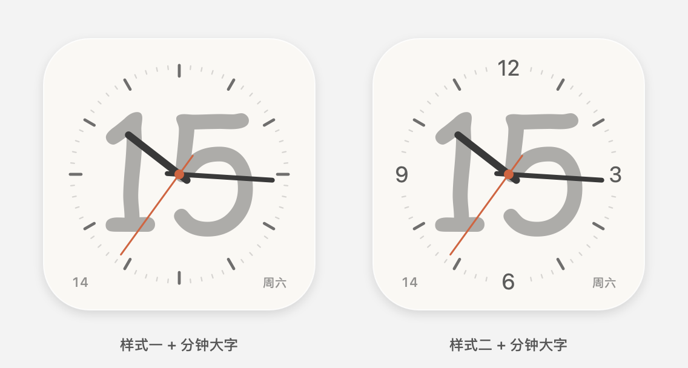
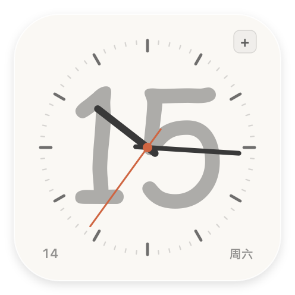
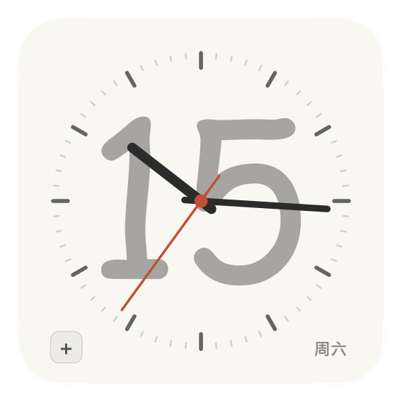
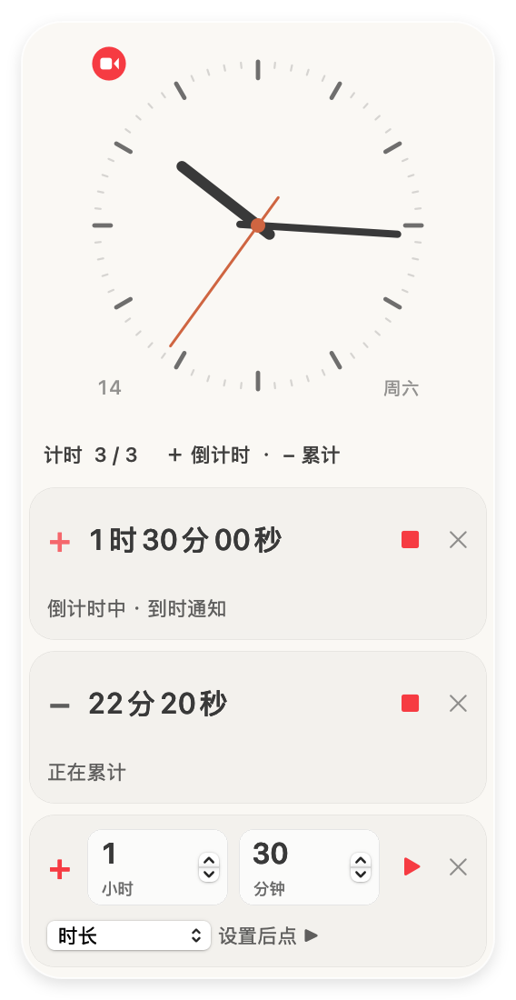
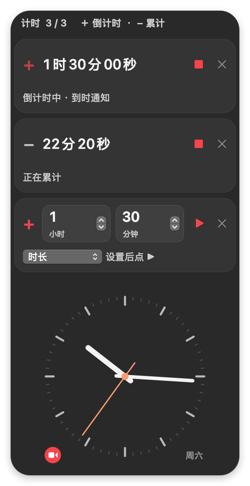
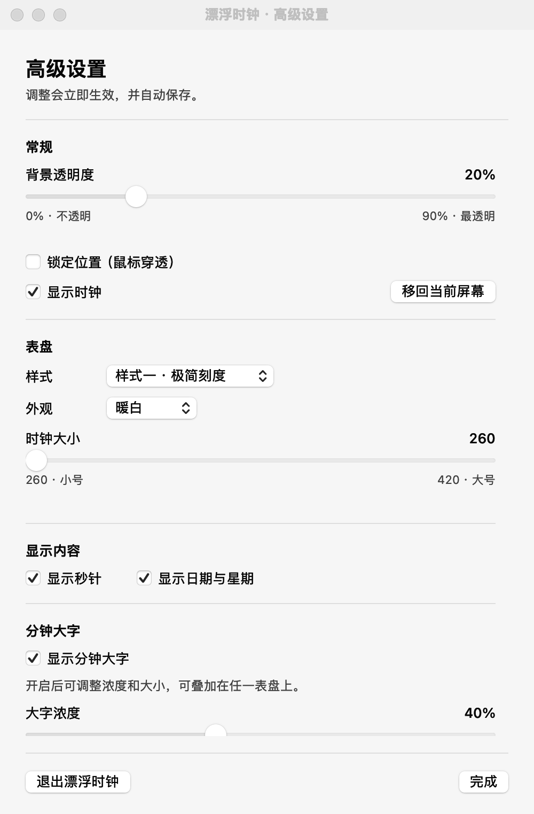
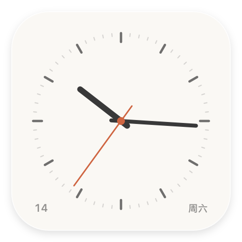
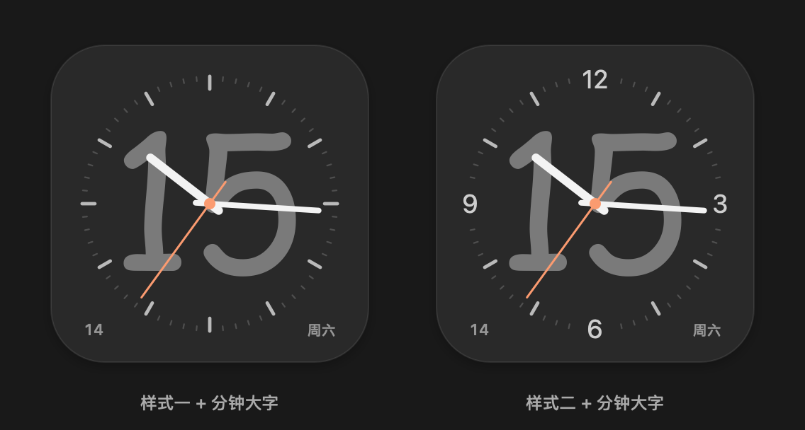
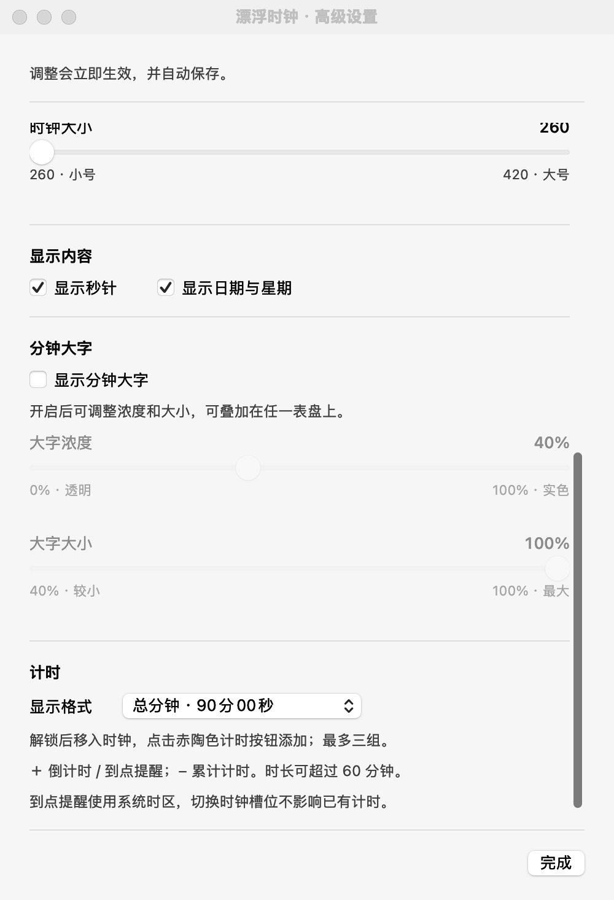
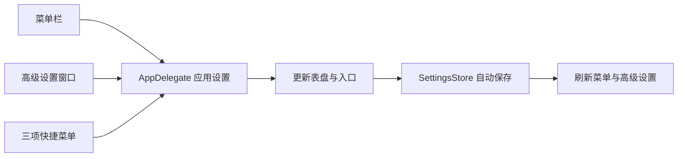

# FloatingClock · 漂浮时钟

一款使用 **Swift + AppKit** 编写的 macOS 原生桌面指针时钟。圆角方形表盘可以自由拖动、悬浮置顶，支持透明度、鼠标穿透、Comic Sans MS 分钟大字、最多三组计时，以及独立的高级设置窗口。



**macOS 13+ · 本地运行 · 无第三方运行依赖 · 中文界面**

[快速开始](#快速开始) · [使用说明](#使用说明) · [高级设置](#高级设置) · [参数与默认值](#参数与默认值) · [技术栈](#技术栈) · [项目结构](#项目结构) · [开发与验证](#开发与验证) · [常见问题](#常见问题)

## 功能概览

- **悬浮置顶**：显示在普通应用窗口和浮动面板上方，不抢走键盘焦点。
- **自由拖动**：未锁定时，按住表盘拖动；位置自动保存。
- **整体透明度**：菜单栏或高级设置中实时调整，范围 0%～90%。
- **两种表盘**：样式一使用极简刻度；样式二显示 12、3、6、9。
- **分钟大字**：可叠加在任一表盘上，使用 Comic Sans MS，并独立调整浓度和大小。
- **独立高级设置**：集中管理样式、外观、大小、显示内容和分钟大字。
- **三项快捷菜单**：表盘右键只保留锁定位置、显示分钟大字、显示秒针。
- **锁定与穿透**：锁定后，表盘区域的点击传给下层窗口，仅保留小“＋”作为快捷入口。
- **条件显示入口**：锁定显示“＋”；解锁后仅鼠标移入时显示红色相机按钮，两者互斥。
- **三组计时**：红色按钮新增计时区，按屏幕位置向上或向下展开；支持倒计时、累计计时及到点通知。
- **计时显示格式**：总分钟（90分00秒）和小时／分钟（1时30分00秒）可在高级设置中切换。
- **入口自动换角**：根据时钟在当前显示器中的位置，将“＋”放在远离较近侧边的角落。
- **多显示器恢复**：保存和恢复窗口位置；显示器断开后，将时钟移回可见区域。
- **本地保存**：所有设置立即生效、自动保存，不需要点击单独的保存按钮。

## 快速开始

### 环境要求

| 项目 | 要求 |
| --- | --- |
| 操作系统 | macOS 13 或更高版本 |
| 已验证硬件 | Apple Silicon Mac |
| 编译工具 | Xcode 或包含 Swift 与 macOS SDK 的 Command Line Tools |
| Swift 工程 | Swift Package Manager，`swift-tools-version: 5.9` |
| 第三方库 | 无 |
| Python 3 | 仅重新生成应用图标时需要 |

当前验证环境为 Apple Silicon、macOS 27.2、Swift 6.4.2。Intel Mac 尚未进行实际兼容性验证；构建脚本默认使用本机架构。

### 从源码构建并启动

先确认本机具备开发工具：

```sh
xcode-select -p
swift --version
```

如果尚未安装 Command Line Tools，可先执行 `xcode-select --install`，完成系统安装提示后再继续。

```sh
git clone https://github.com/lxlonion/FloatingClock.git
cd FloatingClock
bash scripts/build.sh
open dist/FloatingClock.app
```

构建后的应用位于 `dist/FloatingClock.app`。运行已构建的应用不需要再启动 Swift、Python 或其他后台服务。

也可以双击项目根目录的 **启动时钟.command**：已有应用时直接启动；没有构建产物时先执行构建。

> 启动后不会出现 Dock 图标，这是菜单栏应用的正常行为。请在系统右上角寻找时钟图标。

构建脚本使用本地 ad-hoc 签名。仓库以源码构建为主要使用方式，未提供 Apple 开发者证书签名、公证的正式发行流程。

## 使用说明

### 1. 移动和安放时钟

未锁定时，按住表盘拖到需要的位置即可。松开后保存位置，下次启动恢复。

“时钟大小”控制表盘本身的边长；窗口外围还有少量阴影留白。改变大小时会尽量保持表盘中心，并将窗口约束在连接显示器的可见区域内。

如果时钟找不到了，点击菜单栏时钟图标，选择 **移回当前屏幕**，会将它移到鼠标所在显示器的右上区域并显示出来。

### 2. 菜单栏：常用控制与高级设置入口

菜单栏保留一组常用操作：

```text
漂浮时钟
├── 透明度滑块
├── 锁定位置（鼠标穿透）
├── 显示时钟
├── 高级设置…
├── 移回当前屏幕
└── 退出漂浮时钟
```

表盘样式、外观、尺寸和分钟大字参数都已迁移到 **高级设置…**，避免菜单层级过深。

全局透明度的含义是：

- **0%**：整个时钟完全不透明。
- **90%**：整个时钟最透明，仍保留少量可见度。
- 默认 **20%**，拖动滑块立即生效。

### 3. 表盘右键：三项快捷设置

未锁定时，右键点击表盘，只出现下面三项：

```text
锁定位置
显示分钟大字
显示秒针
```

这些开关与菜单栏、高级设置窗口使用同一份设置，状态会同步更新。

这里的“显示秒针”控制指针式秒针，并不是独立的秒表计时功能。

### 4. 锁定、鼠标穿透与小“＋”入口

启用锁定后，表盘不再响应拖动或右键，点击会传给底下的窗口。小“＋”是独立的可点击区域，可以打开同样的三项快捷菜单，并取消勾选“锁定位置”来解锁。

入口的字形大小接近底部日期，按当前显示器的四个象限自动放置：

| 时钟所在区域 | “＋”入口所在位置 |
| --- | --- |
| 左上区域 | 表盘右上角 |
| 右上区域 | 表盘左上角 |
| 左下区域 | 表盘右下日期栏 |
| 右下区域 | 表盘左下日期栏 |

上方入口与底部入口示例：

<p>
  
  
</p>

底部入口会暂时让出对应的日期或星期文字位置。解锁后，“＋”隐藏，鼠标移入时显示红色相机按钮，移出后恢复日期文字。隐藏时钟时两个入口都会隐藏；锁定入口在整体透明度较高时仍保留足够的可见度。


### 5. 红色入口：倒计时、累计计时与到点提醒

**解锁 → 将鼠标移入时钟 → 点击红色相机按钮**，即可添加一组计时，最多三组。这个按钮是计时入口，使用时不需要相机或屏幕录制权限。

计时区与表盘组成一个圆角长方形，靠屏幕上方时向下展开，靠下时向上展开；拖动结束后会重新选择展开方向。删除最后一组后恢复方形表盘。小表盘展开时会增加宽度，保证输入和按钮可用。

<p>
  
  
</p>

| 操作 | 行为 |
| --- | --- |
| 点击行首 `＋` / `−` | 在倒计时和累计计时之间切换；运行时先停止再切换 |
| `＋`，选择“时长” | 从输入时长递减，归零时发送一次系统通知，随后自动转为负数，持续累计超时 |
| `＋`，选择“到点时间” | 输入 `18:30`、`18:30:15` 或 `2026-11-16 09:00`；只填时刻时使用下一次该时刻 |
| `−`，小时和分钟均设为 `0` | 从 `−00分00秒` 开始累计；也可设置已用时作为起点 |
| `▶` / 回车 | 开始计时；停止后可继续 |
| `■` | 停止并保留当前读数 |
| 重设 | 停止或结束后回到可编辑状态 |
| `×` | 删除这一组，同时取消它的待发送通知 |

时长通过两个独立的 **小时 / 分钟数字框** 设置，每个框旁都有原生上下箭头，可直接输入数字或点击调节。修改完成后点击 ▶ 或按回车开始。分钟也可填 `90`，提交后会自动换算为 `1 小时 30 分钟`。旧版保存的混合单位时长会自动显示在新控件中，其中的秒数会保留并在下方提示。

例如，`＋00分02秒 → ＋00分01秒 → −00分00秒 → −00分01秒`。负数表示已经超过设定时间多久，直到停止或删除；停止后可继续累计。到点提醒同样会在到点后进入超时计时。

倒计时开始时，macOS 会请求通知权限，请允许“漂浮时钟”发送通知。拒绝或安排失败时，计时区会显示提示；可到 **系统设置 → 通知 → 漂浮时钟** 开启。通知是否显示横幅和声音也受系统通知设置、专注模式影响。

锁定后，计时区保持显示并穿透鼠标，计时继续；通过“＋”或菜单栏解锁后可停止或删除。隐藏时钟不影响计时和已安排的系统通知。计时状态自动保存，重新启动后按时间恢复；退出应用时已安排的倒计时通知仍交给系统处理。

## 高级设置

点击 **菜单栏时钟图标 → 高级设置…**，打开独立设置窗口。

窗口顶部的“常规”区域也提供透明度、锁定、显示或隐藏时钟及移回当前屏幕；底部可退出应用。菜单栏、快捷菜单和高级设置的状态实时同步。隐藏时钟后，设置窗口仍可操作；“移回当前屏幕”会重新显示时钟。设置内容可上下滚动。



图中为已开启分钟大字的示例配置。所有控件的修改都会立即应用到时钟并保存；“完成”用于关闭窗口，不需要额外点击保存。关闭窗口不会退出时钟，再次打开会显示当前设置。

### 表盘样式

<table>
  <tr><th>样式一 · 极简刻度</th><th>样式二 · 数字刻度</th></tr>
  <tr>
    <td></td>
    <td></td>
  </tr>
</table>

分钟大字是两个表盘共用的叠加选项，不是第三种表盘。

### 外观与尺寸

- **暖白**：浅色表盘、深色指针，搭配橙色秒针。
- **墨黑**：深色表盘、浅色指针。
- **跟随系统**：随系统浅色或深色外观切换。
- **时钟大小**：140～360 连续调节，默认 224。

深色示例：



### 日期和秒针

- “显示秒针”控制秒针是否绘制。
- “显示日期与星期”控制左下角的当天几号和右下角的周几。
- 不显示月份，日期随系统本地时间更新。
- 日期开关与分钟大字开关相互独立。

### 分钟大字

开启 **显示分钟大字** 后，可调整：

| 控件 | 作用 |
| --- | --- |
| 大字浓度 | 0%～100%，数值越高颜色越深，只影响分钟数字 |
| 大字大小 | 40%～100%，相对于表盘内可用空间缩放 |

数字使用 **Comic Sans MS**。当系统没有该字体时，代码会回退到系统字体；仓库不分发字体文件。

数字以实际字形轮廓居中，与时针、分针的原点对齐。指针绘制在大字上方；100% 大小时，数字仍留在刻度圈内，保留小间隙。个位分钟补零，例如 `00`、`05`、`09`。

关闭分钟大字后，浓度和大小控件会变灰，已有数值会保留；重新开启后恢复可调。

<details>
<summary>查看关闭分钟大字时的高级设置界面</summary>



</details>

### 计时显示格式

高级设置底部的“计时”区域提供 **总分钟 · 90分00秒** 和 **小时 / 分钟 · 1时30分00秒**。修改会立即应用于所有计时组并保存，不改变已用时或剩余时间。

## 参数与默认值

| 设置 | 范围 / 选项 | 新安装默认值 | 调整位置 |
| --- | --- | --- | --- |
| 全局透明度 | 0%～90% | 20% | 菜单栏、高级设置 |
| 锁定位置 | 开 / 关 | 关 | 菜单栏、高级设置、快捷菜单 |
| 表盘样式 | 样式一 / 样式二 | 样式一 | 高级设置 |
| 表盘外观 | 暖白 / 墨黑 / 跟随系统 | 暖白 | 高级设置 |
| 表盘大小 | 140～360 points | 224 | 高级设置 |
| 显示秒针 | 开 / 关 | 开 | 高级设置、快捷菜单 |
| 显示日期与星期 | 开 / 关 | 开 | 高级设置 |
| 显示分钟大字 | 开 / 关 | 关 | 高级设置、快捷菜单 |
| 大字浓度 | 0%～100% | 40% | 高级设置 |
| 大字大小 | 40%～100% | 100% | 高级设置 |
| 计时显示格式 | 总分钟 / 小时与分钟 | 总分钟 | 高级设置 |

“全局透明度”越大，整个时钟越透明；“大字浓度”越大，分钟数字越深，两者方向不同。全局透明度作用于整个窗口，大字浓度只改变数字这一层。

升级会保留既有设置。旧版保存的 `style3` 会迁移成“样式一 + 分钟大字”，缺失的大字大小字段使用 100%，避免升级后突然缩小。

## 技术栈

| 技术 | 在项目中的用途 |
| --- | --- |
| Swift | 应用逻辑、窗口控制、绘制、数据模型与测试 |
| Swift Package Manager | 模块组织、构建可执行文件和运行测试 |
| AppKit / Cocoa | `NSPanel` 漂浮窗口、`NSStatusItem` 菜单栏、`NSMenu` 菜单与原生控件 |
| NSWindowController、Auto Layout、NSStackView | 构建和管理独立高级设置窗口 |
| NSBezierPath / Core Graphics | 表盘、刻度、指针、圆角和阴影绘制 |
| Core Text | 提取 Comic Sans MS 数字轮廓，实现按实际字形居中与缩放 |
| Foundation | `Date`、`Calendar`、`Timer`、`Codable` 与本地设置 |
| UserDefaults | 保存表盘偏好与位置 |
| XCTest | 核心逻辑、偏好迁移和布局测试 |
| Shell、Info.plist、codesign | 将 Swift 可执行文件打包为本地签名的 `.app` |

应用直接使用系统原生界面与绘图 API，没有第三方运行依赖。

### 窗口与穿透实现

`ClockPanel` 使用无边框、非激活的 `NSPanel`。窗口层级设在普通应用窗口之上、系统弹出菜单之下，并配置跨桌面和全屏辅助窗口行为。

锁定时将主表盘窗口的 `ignoresMouseEvents` 设为 `true`。小“＋”由单独的 `QuickAccessPanel` 承载，它只覆盖很小的按钮区域，继续接收鼠标输入，并跟随父窗口移动。

这样，主表盘真正穿透鼠标，同时保留一个可解锁的入口，不需要全局鼠标监听。

### 状态同步



`ClockSettings` 是共享的数据模型。各入口产生修改后交给 `AppDelegate` 应用；位置保存回调会保存最新状态，并刷新菜单和已打开的高级设置窗口。控件刷新不会再次触发修改回调。

### 绘制与刷新

- 根据当前系统时间计算指针角度，时针和分针包含分钟、秒的小数部分。
- 开启秒针时约以 30 Hz 请求重绘；关闭秒针时约每秒刷新一次。
- 隐藏时钟会停止绘制定时器，重新显示后恢复。
- 分钟数字的原始字形轮廓会缓存；当前分钟、表盘尺寸或大字大小改变时更新绘制路径。
- 表盘位置与“＋”入口布局以当前显示器为参照，支持负坐标显示器。

## 项目结构

```text
FloatingClock/
├── Package.swift
├── README.md
├── Sources/
│   ├── ClockCore/
│   │   ├── ClockSettings.swift          # 设置模型、兼容迁移与保存
│   │   ├── ClockGeometry.swift          # 指针角度与窗口边界
│   │   ├── ClockReadout.swift           # 几号、星期、分钟文本
│   │   ├── ClockTimer.swift             # 计时状态、输入解析、格式与保存
│   │   ├── TimerAttachmentLayout.swift   # 计时区上下展开布局
│   │   └── QuickAccessLayout.swift      # 加号入口的自动换角与尺寸
│   └── FloatingClock/
│       ├── main.swift                  # 应用生命周期和状态协调
│       ├── ClockPanel.swift            # 漂浮窗口、穿透、显示与隐藏
│       ├── ClockFaceView.swift         # 表盘与指针绘制
│       ├── MinuteNumerals.swift        # 分钟数字字形与缩放
│       ├── MenuController.swift        # 菜单栏和三项快捷菜单
│       ├── AdvancedSettingsWindowController.swift
│       ├── QuickAccessPanel.swift      # 可点击的小加号窗口
│       ├── TimerCoordinator.swift       # 计时调度与系统通知
│       ├── TimerTrayView.swift          # 三组计时的输入和读数
│       └── RuntimeChecks.swift         # 原生检查与文档预览生成
├── Tests/ClockCoreTests/
├── Resources/
│   ├── Info.plist
│   └── AppIcon.icns
├── docs/images/                        # README 使用的图片
├── scripts/
│   ├── build.sh
│   ├── test.sh
│   ├── render-docs.sh
│   ├── regenerate-icon.sh
│   └── generate-icon.swift
└── 启动时钟.command
```

`.build/`、`dist/` 和 `work/` 分别用于编译缓存、应用构建产物和临时文件，均已排除在 Git 提交之外。

## 开发与验证

### 构建应用

```sh
bash scripts/build.sh
```

构建脚本将缓存放在工程的 `.build/` 下，产物放在 `dist/FloatingClock.app`。可以用环境变量指定其他输出目录，例如在不覆盖已安装时钟的情况下构建：

```sh
FLOATING_CLOCK_OUTPUT_DIR="$PWD/work/test-build" bash scripts/build.sh
```

`FLOATING_CLOCK_BUILD_DIR` 可以另外指定 Swift 构建缓存目录。

### 运行测试

```sh
# XCTest 核心逻辑测试
bash scripts/test.sh

# 原生 AppKit 集成检查，需要可用的 macOS 图形会话
./dist/FloatingClock.app/Contents/MacOS/FloatingClock --smoke-test
```

原生检查会短暂显示测试窗口，使用独立的临时 UserDefaults 域，完成后清理测试偏好；不会写入用户实际的时钟设置。通知调度使用替代实现验证安排、取消和延迟回调，不会在测试中请求系统通知授权。

当前合并版本已通过 **30 项核心测试、98 项原生检查**。覆盖内容包括：

- 时间计算、设置边界、保存和旧版迁移。
- 高级设置窗口打开、关闭和复用。
- 高级设置中的常规操作及其与菜单栏之间的状态同步。
- 样式、外观、表盘大小、大字浓度与大小的实时应用。
- 大字关闭时控件禁用、重新开启时恢复原值。
- 快捷菜单与高级设置双向同步。
- 数字缩放比例与中心位置。
- 四角入口、红色悬停入口与锁定“＋”互斥、隐藏联动。
- 超过 60 分钟和混合单位输入、正负计时、停止／继续、归零及跨午夜到点时间。
- 三组添加后分别删除第一、第二、第三组，检查无旧组件残留、行布局无重叠。
- 三组上限、小时／分钟数字框、原生上下调节按钮、输入焦点、上下展开、多显示器坐标、计时保存和通知调度／取消。
- WindowServer 实际命中测试：主表盘穿透，只有小“＋”仍接收点击。

### 重新生成文档图片

```sh
bash scripts/render-docs.sh
```

该脚本会构建到 `work/documentation-build/`，将中间预览写入 `work/documentation-previews/`，再复制文档使用的 10 张图片到 `docs/images/`。不会覆盖 `dist/` 中的已安装应用，也不会更改用户设置。

这些图片直接由当前版本的 AppKit 界面和绘制代码生成；示例时钟时间固定为 10:15、日期为 14 日周六，不包含个人桌面内容。

也可以单独生成更完整的预览：

```sh
./dist/FloatingClock.app/Contents/MacOS/FloatingClock --render-style-previews /tmp/FloatingClock-styles
./dist/FloatingClock.app/Contents/MacOS/FloatingClock --render-quick-previews /tmp/FloatingClock-corners
./dist/FloatingClock.app/Contents/MacOS/FloatingClock --render-timer-previews /tmp/FloatingClock-timers
```

重新生成应用图标使用 `bash scripts/regenerate-icon.sh`，该步骤需要 Python 3。

## 本地数据与隐私

- 应用运行时不联网，不包含账户登录、远程接口或遥测代码。
- 偏好通过 `Codable` 编码后保存在 `UserDefaults`。
- 用户偏好域为 `local.lian.FloatingClock`，数据键为 `FloatingClock.settings.v1`。
- 设置包含表盘样式、外观、透明度、尺寸、显示开关、分钟大字参数、计时格式和窗口位置。
- 最多三组计时以 `FloatingClock.timers.v1` 单独保存；系统通知仅在开始倒计时时申请授权。
- 普通使用不需要辅助功能或屏幕录制权限。
- Comic Sans MS 使用本机字体，仓库不包含字体二进制文件。

## 常见问题

### 为什么找不到 Dock 图标或普通主窗口？

这是菜单栏应用。控制入口在右上角的时钟图标；表盘使用非激活窗口，平时不抢键盘焦点；编辑计时时允许键盘输入，高级设置是可以正常聚焦的独立窗口。

### 锁定后无法拖动、右键没有反应？

这是鼠标穿透的预期行为。点击表盘角落的“＋”，取消勾选“锁定位置”；也可以从菜单栏解锁。

### 大字浓度和大小为什么不能拖动？

先在高级设置中开启“显示分钟大字”。关闭时这两个控件会变灰，数值仍保留。

### 为什么修改大字浓度后，整个时钟没有一起变透明？

大字浓度仅作用于分钟数字。整个时钟的透明度在菜单栏或高级设置中单独调整。

### 日期为什么暂时少了一边？

入口在底部时，“＋”或悬停中的红色按钮会占用那一侧的日期栏位置。解锁并将鼠标移出后，对应文字会恢复，日期开关本身没有改变。

### 拔掉显示器之后，时钟不见了怎么办？

先确认菜单栏中的“显示时钟”已开启，再选择“移回当前屏幕”。程序也会在显示器配置变化时尝试将表盘移回可见区域。

### 是否支持开机自启动、闹钟或计时？

支持三组倒计时、累计计时和到点通知：解锁后将鼠标移入时钟，点击红色相机按钮。“显示秒针”仍只切换指针式秒针。目前未实现开机自启动或重复闹钟。

### 能否保证覆盖所有系统界面？

置顶针对普通应用窗口和浮动面板，并配置了跨桌面、全屏辅助窗口行为。锁屏、安全界面和系统菜单由 macOS 管理；没有逐一验证所有第三方应用的独占全屏模式。

## 参考文档

- [Apple AppKit](https://developer.apple.com/documentation/appkit)
- [非激活 NSPanel](https://developer.apple.com/documentation/appkit/nswindow/stylemask-swift.struct/nonactivatingpanel)
- [NSStatusItem 菜单栏入口](https://developer.apple.com/documentation/appkit/nsstatusitem)
- [窗口鼠标穿透](https://developer.apple.com/documentation/appkit/nswindow/ignoresmouseevents)
- [Core Text](https://developer.apple.com/documentation/coretext)
